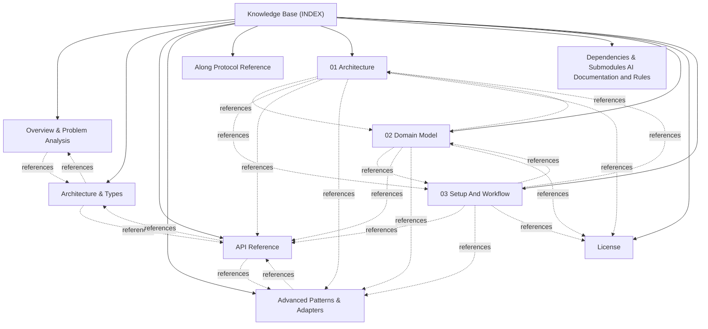

# @actdim/msgmesh - Knowledge Base Topic Index

Central entry point and cross-linked topic catalog for project documentation:

## Knowledge Graph & Topic Map

---

## Articles

- **[Overview & Problem Analysis](./topic--01-overview-and-analysis.md)** (topic) `01-overview-and-analysis`
- **[Architecture & Types](./topic--02-architecture-and-types.md)** (topic) `02-architecture-and-types`
- **[API Reference](./topic--03-api-reference.md)** (topic) `03-api-reference`
- **[Advanced Patterns & Adapters](./topic--04-advanced-patterns.md)** (topic) `04-advanced-patterns`
- **[Along Protocol Reference](./topic--along-protocol.md)** (reference) `protocol`, `agents-md`, `checklist`, `routing`, `concurrency`, `along-team`, `conventions`
- **[01 Architecture](./topic--architecture.md)** (topic) `architecture`
- **[Dependencies & Submodules AI Documentation and Rules](./topic--dependencies.md)** (topic) `dependencies`, `ai-context`, `submodules`, `vendor`, `rules`
- **[02 Domain Model](./topic--domain-model.md)** (topic) `domain-model`
- **[License](./topic--license.md)** (license) `license`, `mit`
- **[03 Setup And Workflow](./topic--setup-and-workflow.md)** (topic) `setup-and-workflow`

---

## Related Context

- [AGENTS.md](../AGENTS.md): Active protocol conventions and rules.
- [Decisions (ADRs)](./decisions/INDEX.md): Architectural Decision Records.
- [Domain Model & Entity Ecosystem](./topic--domain-model.md): Specifications for active issues and project history.
